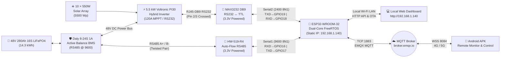

# ⚡ ESP32 Smart Inverter (Voltronic PI30) & Daly 16S LiFePO4 BMS Bridge


-brightgreen)


A **100% wired industrial ESP32 Dual-Core (FreeRTOS)** automation bridge that connects a **Daly 8–24S 1A Active Balance Smart BMS** (on a **48V 280Ah / 16S LiFePO4 — 14.3 kWh** battery bank) to a **5.5 kW Voltronic PI30 / WatchPower** solar inverter, complete with a **fast local Web UI**, **real-time MQTT over 4G/5G**, **30-day kWh energy charts**, **Wi-Fi OTA**, and a **native Android WebView APK**.

> **Why This Project?**
> Most budget Voltronic / clone hybrid inverters lack native LiFePO4 BMS communication. Relying solely on flat LiFePO4 pack voltage causes inaccurate grid/battery switching and risks hitting BMS high-voltage cutoffs during high-current solar charging. This bridge reads true BMS **State of Charge (`% SoC`)**, **all 16 individual cell voltages**, **active balancer status**, and **inverter heatsink temperature** in real time to safely orchestrate charging, switching, and thermal protection.

---

## 🚀 Key Features

- **🔌 100% Wired Industrial Communication:**
  - **Daly BMS** over **RS485 (`HW-519-R4` auto-flow transceiver @ 9600 8N1)** using the standard Daly `0xA5` 13-byte protocol.
  - **Voltronic Inverter** over **RS232 (`MAX3232 DB9` @ 2400 8N1)** using the `PI30` CRC16 protocol (`QPIGS`, `QMOD`, `QPIRI`, `QFLAG`).
- **🧠 Dual-Core FreeRTOS Architecture:**
  - **Core 0:** Daly RS485 polling, Voltronic RS232 polling, NTP kWh energy integrator, battery longevity & thermal automation, and MQTT publishing.
  - **Core 1:** Dedicated `100%` to the local Web Server & REST API (`~20 ms` response time, zero UI lag).
- **🔋 10–15 Year LiFePO4 Battery Longevity Profile (`20% – 92%`):**
  - **Configurable Max SoC Charge Cap** (default `92%`, one-tap `80% / 90% / 92% / 95% / 100%`): Temporarily lowers Bulk/Float to `52.8V` so solar panels continue powering household loads while putting **`0A`** into the battery; resumes automatically at `maxSoc - 3%`.
  - **Multi-Stage Tapered Charging (`80A → 40A → 10A`):** Gentle `~0.28C` bulk charge (`80A`), tapering down at `88% / 3.42V` (`40A`) and `94% / 3.47V` (`10A`) so the Daly 1A active balancer can effortlessly top-balance cells (`3.55V` emergency cell brake).
  - **True SoC & Lowest-Cell Switching:** Automatically switches between **SBU (Battery + Solar)** and **UTI (Utility Grid)** based on real BMS `% SoC` and minimum cell voltage, plus optional winter emergency grid top-up (`12% → 20%`).
- **🌡️ 3-Stage Inverter Over-Temperature Throttling & Emergency Grid Bypass:**
  - `≥ 58 °C` → Immediately throttles charge current to **`40A`** (recovers at `≤ 54 °C`).
  - `≥ 64 °C` → Immediately throttles charge current to **`10A`** (recovers at `≤ 59 °C`).
  - `≥ 70 °C` → **EMERGENCY THERMAL BYPASS:** Immediately forces **`POP00` (Utility Grid Bypass) + `10A` charge**, removing AC load stress from the inverter's IGBTs/MOSFETs without interrupting household power. Automatically returns to **`POP02` (SBU)** once cooled to **`≤ 60 °C`** (and battery `≥ 30%`).
  - Runs at **highest priority** — bypasses the 45s EEPROM cooldown and operates even if the BMS is momentarily offline.
- **📊 Live 16-Cell Matrix & Full Daly BMS Telemetry:** Individual millivolt bars, live `⚖️` 1A active balance cell indicators (`0x97`), total cycle count (`0x94`), live fault flags (`0x98`), internal OVP/UVP/OCP/temperature thresholds (`0x50–0x5F`), and Charge/Discharge MOSFET status.
- **⚙️ Full Live WatchPower Inverter Menu (17 Settings):** Control Output Priority (`POP`), Charge Priority (`PCP`), Max Charge Current (`10A–110A`), Utility Charge Current (`MUCHGC`), Battery Type (`PBT`), AC Input Range (`PGR`), Bulk/Float/Cut-Off/Back-to-Grid/Back-to-Battery voltages, and `QFLAG` switches (Buzzer, Bypass, Power Saving, LCD Backlight).
- **📈 30-Day & 24-Hour Energy Analytics:** NTP-synced real-time Watt-to-kWh integration stored in ESP32 NVS Flash, rendered as interactive HTML5 Canvas bar charts (PV Production, Home Load, Battery Charge/Discharge, Grid Bypass, Grid Charge).
- **📡 Local Wi-Fi + Global MQTT + Wi-Fi OTA + Android APK:** Zero-latency LAN access (`http://192.168.1.140`), global remote access via `MQTT over WSS`, wireless firmware flashing (`/update`), and native Android WebView APK source.

---

## 🧰 Hardware & Software Bill of Materials (BOM)

### Hardware Components
| Component | Model / Specification | Purpose |
| :--- | :--- | :--- |
| **Microcontroller** | `ESP32-WROOM-32` (`ESP32-D0WD-V3`, 30/38-pin DevKit) | Core controller, Dual-Core FreeRTOS, Web Server, MQTT client |
| **RS485 Transceiver** | `HW-519-R4` (Auto-Flow Direction Control TTL ↔ RS485, 3.3V–5V) | Wired Daly BMS RS485 interface (no manual `DE/RE` pin needed) |
| **RS232 Transceiver** | `MAX3232` DB9 Female RS232 ↔ TTL Module (`3.3V` compatible) | Wired Voltronic WatchPower RS232 interface |
| **Inverter Serial Cable** | Standard `RJ45 → DB9` WatchPower Serial Cable | Connects inverter RS232 port to `MAX3232` DB9 connector |
| **Battery Pack & BMS** | `48V 280Ah (16S LiFePO4 — 14.3 kWh)` + `Daly 8–24S 1A Active Balance Smart BMS` | Energy storage & RS485 (`0xA5` 13-byte) live telemetry |
| **Solar Inverter** | `5.5 kW (5500W / 48V / 120A MPPT)` Voltronic `PI30` Compatible | Solar MPPT charging and AC load management |
| **Solar Array** | `10 × 550W` (`5500 Wp`) Monocrystalline Panels | Primary solar generation |
| **Power & Wiring** | `5V 2A` USB PSU (for ESP32) + Female-to-Female Dupont wires + Twisted-pair RS485 cable | Stable power delivery and noise-immune serial lines |

### Software & Libraries
| Software / Library | Version / Notes |
| :--- | :--- |
| **Arduino IDE / Arduino CLI** | `esp32:esp32` Board Package (`v3.x`) |
| **PubSubClient** | `v2.8.0+` — Real-time MQTT client (`4096`-byte buffer) |
| **Built-in ESP32 Core Libraries** | `WiFi`, `WebServer`, `Preferences` (NVS), `ESPmDNS`, `Update` (Wi-Fi OTA), `time.h` (NTP) |
| **Web / Mobile Frontend** | Zero-framework HTML5 + CSS3 + Vanilla JS + HTML5 Canvas + bundled `mqtt.min.js` (`v5.10.1` WSS) |
| **Android APK Toolchain** | Native Android `WebView` (`minSdk 24`, `targetSdk 34`), `OpenJDK 17`, `Android SDK Build-Tools 34` |

---

## 🗺️ System Architecture & Wiring Schematics

### 1. System Architecture Diagram (Mermaid)



### 2. Pin-by-Pin Hardware Wiring Schematic (ASCII)

```text
  ┌─────────────────────────┐             ┌──────────────────────────┐
  │   DALY 16S SMART BMS    │             │  5.5kW VOLTRONIC PI30    │
  │   (RS485 Port: A+, B-)  │             │  INVERTER (RJ45 RS232)   │
  └──────────┬───┬──────────┘             └────────────┬─────────────┘
          A+ │   │ B-                                  │ RJ45 → DB9 Cable
             │   │                                     │ (DB9 Pin 2 & 3 Crossed)
  ┌──────────▼───▼──────────┐             ┌────────────▼─────────────┐
  │     HW-519-R4 RS485     │             │    MAX3232 DB9 MODULE    │
  │  (Auto-Flow Direction)  │             │   (RS232 ↔ 3.3V TTL)     │
  │  VCC  GND   RXD    TXD  │             │  VCC  GND   TXD    RXD   │
  └───┬────┬─────┬──────┬───┘             └───┬────┬─────┬──────┬────┘
      │    │     │      │                     │    │     │      │
  3.3V│ GND│     │      │                 3.3V│ GND│     │      │
      │    │     │      │                     │    │     │      │
  ┌───▼────▼─────▼──────▼─────────────────────▼────▼─────▼──────▼────┐
  │  3V3  GND  GPIO16 GPIO17                 3V3  GND  GPIO19 GPIO18 │
  │            (RX1)  (TX1)                            (RX2)  (TX2)  │
  │                                                                  │
  │                    ESP32-WROOM-32 DEVKIT                         │
  │              [Powered via 5V 2A USB Power Supply]                │
  └──────────────────────────────────────────────────────────────────┘
```

### 3. Detailed Pinout Tables

#### A) Daly BMS ↔ `HW-519-R4` (RS485) ↔ ESP32 (`Serial1` @ `9600 8N1`)
| `HW-519-R4` Module Pin | Connected To | Notes |
| :--- | :--- | :--- |
| **`VCC`** | ESP32 **`3V3`** | **Important:** Always power with **`3.3V`** to match ESP32 GPIO logic levels (do **not** use `5V`). |
| **`GND`** | ESP32 **`GND`** | Common ground reference. |
| **`RXD`** | ESP32 **`GPIO 16`** (`RX1`) | On `HW-519-R4`, silkscreen labels map straight (`RXD → GPIO16`). Firmware also auto-detects idle 3.3V line at boot. |
| **`TXD`** | ESP32 **`GPIO 17`** (`TX1`) | Sends Daly `0xA5` query frames to the BMS. |
| **`A+`** (Terminal) | Daly BMS RS485 **`A+`** | Differential RS485 positive line. |
| **`B-`** (Terminal) | Daly BMS RS485 **`B-`** | Differential RS485 negative line. |

> **Daly BMS App Setting:** In the Daly Smart BMS Bluetooth app, make sure the communication port is set to **`RS485`** (standard Daly `0xA5` protocol, `9600 baud`, Host `0x40`).

#### B) Voltronic Inverter ↔ `MAX3232 DB9` (RS232) ↔ ESP32 (`Serial2` @ `2400 8N1`)
| `MAX3232` Module Pin | Connected To | Notes |
| :--- | :--- | :--- |
| **`VCC`** | ESP32 **`3V3`** | **Important:** Always power with **`3.3V`** (`5V` can damage ESP32 GPIO pins). |
| **`GND`** | ESP32 **`GND`** | Common ground reference. |
| **`TXD`** (or `TX`) | ESP32 **`GPIO 19`** (`RX2`) | Receives RS232→TTL data from inverter (`3.3V` idle-high line). |
| **`RXD`** (or `RX`) | ESP32 **`GPIO 18`** (`TX2`) | Transmits WatchPower PI30 commands to inverter. |
| **DB9 Connector** | Inverter `RJ45 → DB9` Cable | **Critical:** Most straight-through DB9 cables will receive 0 bytes. **DB9 Pin 2 (RX)** and **Pin 3 (TX)** must be crossed (Null-Modem), with **Pin 5 = GND**. |

---

## 🛠️ Step-by-Step Installation Guide

### Step 1: Clone the Repository & Create Your Local Secret Files
For security, personal Wi-Fi credentials and private MQTT topics are gitignored. Copy the example templates and fill in your own values:

1. Copy `esp32_daly_inverter_bridge/secrets.example.h` to **`esp32_daly_inverter_bridge/secrets.h`** and edit it:
   ```cpp
   #pragma once
   #define WIFI_SSID_CFG     "YOUR_2.4G_WIFI_SSID"
   #define WIFI_PASS_CFG     "YOUR_WIFI_PASSWORD"
   #define MQTT_PREFIX_CFG   "dalyinv/YOUR_UNIQUE_SECRET_ID"
   ```
   > **Security Tip:** Make `MQTT_PREFIX_CFG` a long, unpredictable random string (e.g., `dalyinv/home_9f4a7c2e81b3`) since it accepts live inverter & BMS control commands over the public EMQX broker.
2. For remote 4G/5G APK access, copy `mobil_uygulama/mqtt_config.example.js` to **`mobil_uygulama/mqtt_config.js`** with the exact same `MQTT_PREFIX_CFG`:
   ```javascript
   window.MQTT_PREFIX = 'dalyinv/YOUR_UNIQUE_SECRET_ID';
   ```
3. (Optional) Adjust `staticIP(192, 168, 1, 140)` and `gateway(192, 168, 1, 1)` in `esp32_daly_inverter_bridge.ino` to match your router's subnet.

### Step 2: Compile & Flash ESP32 (Arduino IDE or CLI)

#### Option A — Arduino IDE:
1. Install **`esp32` by Espressif Systems (`v3.x`)** via **Boards Manager**.
2. Install **`PubSubClient`** by Nick O'Leary via **Library Manager**.
3. Open `esp32_daly_inverter_bridge/esp32_daly_inverter_bridge.ino`.
4. Select Board **`ESP32 Dev Module`**, pick your USB COM port, and click **Upload**.

#### Option B — Arduino CLI:
```powershell
arduino-cli compile --fqbn esp32:esp32:esp32 --output-dir ".\esp32_daly_inverter_bridge\build" ".\esp32_daly_inverter_bridge"
arduino-cli upload -p COM3 --fqbn esp32:esp32:esp32 ".\esp32_daly_inverter_bridge"
```

### Step 3: Wireless Firmware Updates (Wi-Fi OTA)
After the first USB flash, you never need a USB cable or BOOT button again:
```powershell
curl.exe -s --max-time 30 -F "update=@esp32_daly_inverter_bridge/build/esp32_daly_inverter_bridge.ino.bin" "http://192.168.1.140/update"
```
When the server replies **`OK`**, the ESP32 automatically reboots into the new firmware within ~5 seconds.

### Step 4: Web Dashboard & Native Android `.APK`
- **Local LAN / PWA:** Open `http://192.168.1.140` or `http://akilli-inverter.local` on any phone or PC (tap *"Add to Home Screen"* for full-screen PWA mode).
- **Building Your Own Signed Android `.APK`:** Full native WebView source code is in `android_apk_src/`. Copy `mobil_uygulama/index.html`, `mqtt.min.js`, and your private `mqtt_config.js` into `android_apk_src/assets/`, then build & sign with `aapt2` + `d8` + `zipalign` + `apksigner` (or Android Studio).

---

## 🔋 Battery Longevity & Thermal Protection Profiles

### 1. 16S LiFePO4 Longevity Profile (10–15 Years / 6,000–10,000 Cycles)
| Parameter | Default Value | Purpose |
| :--- | :---: | :--- |
| **Bulk / Absorption Voltage (`PCVV`)** | **`55.0 V`** (`3.437 V/cell`) | Full usable charge without high-voltage stress |
| **Float Voltage (`PBFT`)** | **`53.6 V`** (`3.350 V/cell`) | Gentle daytime resting voltage |
| **Low DC Cut-Off (`PSDV`)** | **`45.0 V`** (`2.812 V/cell`) | Hardware safety floor |
| **Daily Operating SoC Window** | **`20% – 92%`** | At `92%`, charging halts to `0A` (`52.8V` cap); re-enables at `89%` |
| **Grid / Battery Switching** | **`20%` → `30%`** | Also switches to Grid (`POP00`) if any cell drops `≤ 3.00 V` |
| **Emergency Winter Grid Support** | **`12%` → `20%`** | Enables `10A` utility support (`PCP02`) below `12%`, returns to Solar-Only (`PCP03`) at `20%` |
| **Tapered Charge Curve (280Ah)** | **`80A → 40A → 10A`** | `<86%`: `80A` (`~0.28C`), `88% / 3.42V`: `40A`, `94% / 3.47V`: `10A`, `≥3.55V`: emergency brake |
| **Daly 1A Active Balance (Recommended)** | **`3.40 V / 15 mV`** | Top-balancing above the flat LiFePO4 voltage plateau (configure via Smart BMS app) |

### 2. 3-Stage Inverter Over-Temperature Protection (`inv.invTemp`)
Thermal protection runs at **highest priority** (ignores the 45s cooldown on temperature escalation and stays active even if BMS disconnects):

| Stage | Trigger Temperature | Automatic Action | Recovery Hysteresis |
| :--- | :---: | :--- | :---: |
| **Normal** | `< 58 °C` | Normal battery-longevity charging (`80A / 40A / 10A`) | — |
| **Stage 1 (Throttle-1)** | `≥ 58 °C` | Immediately caps charge current to **`40A`** | `≤ 54 °C` |
| **Stage 2 (Throttle-2)** | `≥ 64 °C` | Immediately caps charge current to **`10A`** | `≤ 59 °C` |
| **Stage 3 (EMERGENCY BYPASS)** | **`≥ 70 °C`** | Immediately forces **`POP00` (Grid Bypass) + `10A`** | **`≤ 60 °C`** → Auto-returns to `POP02` (SBU) |

---

## 📡 HTTP REST API & MQTT Topics

| Endpoint / Topic | Description |
| :--- | :--- |
| `GET /api/status` | Full JSON telemetry: Daly BMS + 16 cells + `bmsSet`, Inverter live data + `QPIRI`/`QFLAG`, thermal state, and config |
| `GET /api/stats` | Today's 24-hour curve and rolling 30-day kWh energy statistics |
| `GET /api/cmd?c=<CMD>` | Sends inverter command (`POP02`, `PCP03`, `MNCHGC0080`, `PCVV55.0`, etc.) or BMS command (`BMS:CHGMOS:1`, `BMS:BAL:3400:15`) |
| `GET /api/cfg?...` | Persists automation & thermal thresholds (`tWarn`, `tHigh`, `tByp`, `maxS`, `socG`, `socB`, etc.) into NVS Flash |
| `GET /api/apply_lifepo4` | One-click writes the complete 16S LiFePO4 voltage profile (`PBT02`, `PCVV55.0`, `PBFT53.6`, `PSDV45.0`, `PBCV46.0`, `PBDV53.0`) |
| `GET /api/bms_probe` | Live `HW-519-R4` RS485 pin idle-voltage & protocol diagnostic tool (`0x40` / `0x80` / Modbus) |
| `GET /api/hunt` | Multi-baud RS232 protocol hunter (`PI30` / `PI18` / Megatec / Modbus) |
| `POST /update` | Wireless Wi-Fi OTA `.bin` firmware upload endpoint |
| `MQTT: <PREFIX>/status` | Retained live JSON status published every 3 seconds |
| `MQTT: <PREFIX>/stats` | Retained 30-day/24-hour energy JSON published every 12 seconds |
| `MQTT: <PREFIX>/cmd` & `/cfg` | Remote command and configuration topics for the Android APK |

---

## 🔧 Real-World Field Notes & Troubleshooting

1. **80A–110A Charge Command Format (`MNCHGC0080`–`MNCHGC0110`):** Many 5.5 kW Voltronic PI30 inverters reject 3-digit `MCHGC080`/`MNCHGC100` with `(NAK` and strictly require the **4-digit `MNCHGC0%03d`** format (`010`–`110` in `10A` steps). `setInverterChargeAmp()` handles this automatically.
2. **Voltronic CRC16 Bytes Breaking JSON:** Raw Voltronic responses end with 2 binary CRC16 bytes that occasionally equal `0x22` (`"`), breaking naive string parsing. This firmware buffers raw bytes up to `\r` and strips the exact last 2 raw CRC bytes before parsing ASCII.
3. **Daly BMS RS485 Config Write Lock:** While Daly RS485 reads all telemetry (`0x90–0x98`) and internal protection settings (`0x50–0x5F`) reliably, newer active-balance Daly firmware revisions reject unsigned RS485 writes (`0x1F`) without an engineering unlock sequence. Adjust `1A Balance Start Voltage` (`3.40V / 15mV`) directly in the Smart BMS Bluetooth app (default PIN `123456`).
4. **EEPROM Protection:** Normal automation enforces a minimum **45-second cooldown** and only sends commands when target state actually changes (thermal escalations and explicit user config saves bypass the cooldown for instant response).

---

## 📁 Project Structure

```text
├── README.md                                  # Project documentation & wiring schematics
├── .gitignore                                 # Excludes secrets, keystores, APKs, and build artifacts
├── esp32_daly_inverter_bridge/
│   ├── esp32_daly_inverter_bridge.ino         # Main Dual-Core ESP32 firmware
│   ├── energy_stats.h                         # NTP + 30-day / 24-hour kWh NVS storage engine
│   ├── web_ui.h                               # Embedded PROGMEM Web UI header
│   └── secrets.example.h                      # Wi-Fi & MQTT template (copy to secrets.h)
├── mobil_uygulama/
│   ├── index.html                             # Responsive Web / PWA / APK dashboard
│   ├── mqtt.min.js                            # Bundled offline MQTT.js client
│   ├── mqtt_config.example.js                 # Remote MQTT topic template (copy to mqtt_config.js)
│   └── manifest.json                          # PWA manifest
└── android_apk_src/
    ├── AndroidManifest.xml                    # Native Android WebView manifest
    ├── src/com/kaan/dalyinverter/MainActivity.java
    ├── res/                                   # App launcher icon resources
    └── assets/                                # Bundled web UI assets for APK compilation
```

---

## ⚠️ Safety Disclaimer

- `48V` DC battery banks can deliver lethal fault currents and `230V` AC inverter outputs carry shock hazards. Always isolate DC/AC breakers before wiring.
- Power both `HW-519-R4` and `MAX3232` strictly from the ESP32 **`3V3`** (`3.3V`) rail.
- Never commit `secrets.h`, `mqtt_config.js`, or private Android `.keystore` files to public repositories.
