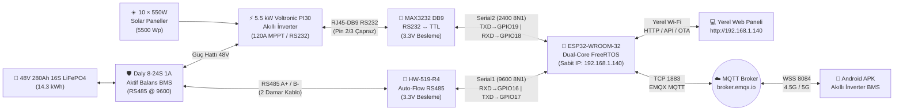

# ⚡ ESP32 Akıllı İnverter (Voltronic PI30) & Daly 16S LiFePO4 BMS Köprüsü


-brightgreen)


**48V 280Ah (16S LiFePO4 — 14.3 kWh)** akü paketindeki **Daly 1A Aktif Balanslı Smart BMS** ile **5.5 kW Voltronic PI30 / WatchPower** uyumlu akıllı solar inverteri, **%100 endüstriyel kablolu haberleşme (RS485 + RS232)** üzerinden birleştiren, **çift çekirdekli (Dual-Core FreeRTOS) ESP32** otomasyon köprüsü, yerel Web paneli ve **4.5G/5G gerçek zamanlı MQTT Android APK** projesidir.

> **Neden Bu Proje?**
> Çoğu ekonomik Voltronic/Çin klon akıllı inverterde gerçek LiFePO4 SoC haberleşmesi yoktur; sadece akü voltajına bakarak hatalı zamanda şebekeye geçer veya hücreler dengesizken tam güçle şarj basarak BMS kesmesine yol açar. Bu proje gerçek BMS yüzdesini (`% SoC`), 16 hücre voltajını ve inverter sıcaklığını saniye saniye okuyarak inverteri akıllıca yönetir.

---

## 🚀 Temel Özellikler

- **🔌 %100 Kablolu Endüstriyel Bağlantı:** Daly BMS ile **RS485 (`HW-519-R4`)**, İnverter ile **RS232 (`MAX3232 DB9`)** üzerinden kesintisiz haberleşme.
- **🧠 Çift Çekirdekli (Dual-Core FreeRTOS) Mimari:**
  - **Çekirdek 0:** Daly BMS RS485 okuma, Voltronic RS232 (`QPIGS`/`QMOD`/`QPIRI`/`QFLAG`), kWh enerji sayacı, pil ömrü/termal otomasyon ve MQTT yayını.
  - **Çekirdek 1:** `%100` Web sunucusu ve mobil arayüze ayrılmış (`~20 ms` anlık yanıt, sıfır donma).
- **🔋 10–15 Yıl Pil Ömrü Profili (`%20 – %92`):**
  - Üst şarj sınırı (`%92` varsayılan, tek tıkla `%80 / %90 / %92 / %95 / %100`): Akü sınıra gelince şarjı **`0A`** durdurur, paneller sadece ev yükünü besler.
  - Kademeli yumuşak şarj eğrisi (`80A → 40A → 10A`) ve hücre tepe freni (`3.42V / 3.47V / 3.55V`).
  - Gerçek BMS `% SoC` ve en düşük hücre voltajına göre otomatik **SBU (Akü/Solar)** ↔ **UTI (Şebeke)** geçişi + kış acil şebeke şarjı.
- **🌡️ İnverter 3 Kademeli Aşırı Isınma Koruması (Termal Kısma + Acil Bypass):**
  - `≥ 58 °C` → Şarjı **`40A`**'e kısar.
  - `≥ 64 °C` → Şarjı **`10A`**'e kısar.
  - `≥ 70 °C` → **ACİL TERMAL BYPASS:** Anında **`POP00` (Şebeke Bypass) + `10A`** göndererek ev elektriğini kesmeden inverter yükünü sıfırlar; `≤ 60 °C` soğuyunca otomatik **`POP02` (SBU)** moduna döner.
- **📊 Canlı 16 Hücre Matrisi & Daly BMS Tüm Ayarlar:** Her hücrenin milivolt bazlı takibi, `⚖️` canlı 1A aktif balans göstergesi, toplam döngü sayısı (`Cycles`), OVP/UVP/OCP/Sıcaklık limitleri ve MOSFET durumu.
- **⚙️ Canlı WatchPower İnverter Menüsü (17 Ayar):** `POP`, `PCP`, `MCHGC/MNCHGC (10A–110A)`, `MUCHGC`, `PBT`, `PGR`, `PCVV`, `PBFT`, `PSDV`, `PBCV`, `PBDV` ve `QFLAG` (Buzzer, Bypass, Tasarruf, LCD) tek ekrandan canlı kontrol.
- **📈 30 Günlük & 24 Saatlik Enerji Grafikleri:** NTP Türkiye saati (`UTC+3`) ile NVS Flash bellekte saklanan günlük/aylık Solar Üretim, Ev Tüketimi, Akü Dolum/Kullanım ve Şebeke kWh grafikleri.
- **📡 Wi-Fi OTA & 4.5G/5G Android APK:** Evdeyken yerel Wi-Fi (`http://192.168.1.140`), dışarıdayken gerçek zamanlı `MQTT over WSS` ile anlık erişim ve kablosuz yazılım güncelleme (`/update`).

---

## 🧰 Kullanılan Donanım ve Yazılımlar (Malzeme Listesi)

### Donanım Bileşenleri
| Bileşen | Model / Özellik | Kullanım Amacı |
| :--- | :--- | :--- |
| **Mikrodenetleyici** | `ESP32-WROOM-32` (`ESP32-D0WD-V3`, 30/38 pin) | Ana beyin, Web sunucusu, MQTT istemcisi, FreeRTOS otomasyon |
| **RS485 Modülü** | `HW-519-R4` (Otomatik Yön / Auto-Flow TTL ↔ RS485, 3.3V–5V) | Daly BMS RS485 portuyla `DE/RE` pini gerektirmeden haberleşme |
| **RS232 Modülü** | `MAX3232` DB9 Dişi RS232 ↔ TTL Dönüştürücü (`3.3V` uyumlu) | Voltronic inverterin WatchPower RS232 portuyla haberleşme |
| **İnverter Kablosu** | Standart `RJ45 → DB9` WatchPower Seri Kablosu | İnverter RS232 çıkışını MAX3232 modülüne bağlamak için |
| **Akü & BMS** | `48V 280Ah (16S LiFePO4 — 14.3 kWh)` + `Daly 8-24S 1A Aktif Balans Smart BMS` | Enerji depolama ve RS485 (`0xA5` 13-byte) canlı hücre telemetrisi |
| **Akıllı İnverter** | `5.5 kW (5500W / 48V / 120A MPPT)` Voltronic `PI30` Uyumlu | Solar MPPT şarj ve AC yük yönetimi |
| **Solar Paneller** | `10 × 550W` (`5500 Wp`) Monokristal Panel Dizisi | Ana güneş enerjisi kaynağı |
| **Besleme & Kablolama** | `5V 2A` USB Adaptör (ESP32 için) + Dişi-Dişi Dupont Kablolar + 2 Damar Bükülü RS485 Kablosu | Kararlı 3.3V/5V besleme ve parazitsiz seri hat |

### Yazılım & Kütüphaneler
| Yazılım / Araç | Sürüm / Açıklama |
| :--- | :--- |
| **Arduino IDE / Arduino CLI** | `esp32:esp32` Kart Paketi (`v3.x`) |
| **PubSubClient** | `v2.8.0+` — Gerçek zamanlı MQTT haberleşmesi (`4096` byte tampon) |
| **Dahili ESP32 Kütüphaneleri** | `WiFi`, `WebServer`, `Preferences` (NVS Flash), `ESPmDNS`, `Update` (Wi-Fi OTA), `time.h` (NTP) |
| **Ön Yüz (Web / PWA / APK)** | Saf HTML5 + CSS3 + Vanilla JS + Canvas Grafik + `mqtt.min.js` (`v5.10.1` WSS) |
| **Android APK Derleme** | Native Android `WebView` (`minSdk 24`, `targetSdk 34`), `OpenJDK 17`, `Android SDK Build-Tools 34` |

---

## 🗺️ Sistem Mimarisi ve Bağlantı Şeması

### 1. Genel Sistem Akış Diyagramı (Mermaid)



### 2. Birebir Donanım Bağlantı Şeması (ASCII)

```text
  ┌─────────────────────────┐             ┌──────────────────────────┐
  │   DALY 16S SMART BMS    │             │  5.5kW VOLTRONIC PI30    │
  │   (RS485 Portu: A+, B-) │             │  İNVERTER (RJ45 RS232)   │
  └──────────┬───┬──────────┘             └────────────┬─────────────┘
          A+ │   │ B-                                  │ RJ45 → DB9 Kablo
             │   │                                     │ (DB9 Pin 2 & 3 Çapraz)
  ┌──────────▼───▼──────────┐             ┌────────────▼─────────────┐
  │     HW-519-R4 RS485     │             │    MAX3232 DB9 MODÜL     │
  │  (Otomatik Yön Akışlı)  │             │   (RS232 ↔ 3.3V TTL)     │
  │  VCC  GND   RXD    TXD  │             │  VCC  GND   TXD    RXD   │
  └───┬────┬─────┬──────┬───┘             └───┬────┬─────┬──────┬────┘
      │    │     │      │                     │    │     │      │
  3.3V│ GND│     │      │                 3.3V│ GND│     │      │
      │    │     │      │                     │    │     │      │
  ┌───▼────▼─────▼──────▼─────────────────────▼────▼─────▼──────▼────┐
  │  3V3  GND  GPIO16 GPIO17                 3V3  GND  GPIO19 GPIO18 │
  │            (RX1)  (TX1)                            (RX2)  (TX2)  │
  │                                                                  │
  │                    ESP32-WROOM-32 DEVKIT                         │
  │              [USB 5V 2A Adaptör ile Beslenir]                    │
  └──────────────────────────────────────────────────────────────────┘
```

### 3. Detaylı Pin Bağlantı Tabloları

#### A) Daly BMS ↔ `HW-519-R4` (RS485) ↔ ESP32 (`Serial1` @ `9600 8N1`)
| `HW-519-R4` Modül Pini | Bağlandığı Yer | Açıklama |
| :--- | :--- | :--- |
| **`VCC`** | ESP32 **`3V3`** | **Önemli:** ESP32 lojik seviyesi için mutlaka **`3.3V`** ile besleyin (`5V` kullanmayın). |
| **`GND`** | ESP32 **`GND`** | Ortak şase (toprak). |
| **`RXD`** | ESP32 **`GPIO 16`** (`RX1`) | HW-519-R4 kartında etiket yönü düz çalışır (`RXD → GPIO16`). Firmware açılışta 3.3V boşta gerilimini de kontrol eder. |
| **`TXD`** | ESP32 **`GPIO 17`** (`TX1`) | ESP32'den Daly BMS'e sorgu gönderim hattı. |
| **`A+`** (Klemens) | Daly BMS RS485 **`A+`** | Diferansiyel pozitif veri hattı. |
| **`B-`** (Klemens) | Daly BMS RS485 **`B-`** | Diferansiyel negatif veri hattı. |

> **Daly BMS Uygulama Ayarı:** Smart BMS Bluetooth uygulamasında haberleşme modunun **`RS485`** (Daly standart `0xA5` protokolü, `9600 baud`, Host `0x40`) olduğundan emin olun.

#### B) Voltronic İnverter ↔ `MAX3232 DB9` (RS232) ↔ ESP32 (`Serial2` @ `2400 8N1`)
| `MAX3232` Modül Pini | Bağlandığı Yer | Açıklama |
| :--- | :--- | :--- |
| **`VCC`** | ESP32 **`3V3`** | **Önemli:** Mutlaka **`3.3V`** verin (`5V` ESP32 RX pinine zarar verebilir). |
| **`GND`** | ESP32 **`GND`** | Ortak şase. |
| **`TXD`** (veya `TX`) | ESP32 **`GPIO 19`** (`RX2`) | MAX3232'den ESP32'ye veri girişi (`3.3V` aktif hat). |
| **`RXD`** (veya `RX`) | ESP32 **`GPIO 18`** (`TX2`) | ESP32'den invertere komut gönderimi. |
| **DB9 Portu** | İnverter `RJ45 → DB9` Kablosu | **Kritik Not:** Çoğu düz DB9 kablosuyla veri gelmez; DB9 **Pin 2 (RX)** ile **Pin 3 (TX)** çapraz (Null-Modem) olmalıdır (`Pin 5 = GND`). |

---

## 🛠️ Adım Adım Kurulum Rehberi

### 1. Depoyu İndirin ve Gizli Ayar Dosyalarını Oluşturun
Güvenlik nedeniyle kişisel Wi-Fi şifreniz ve özel MQTT kanalınız depoya dahil edilmez. Şablon dosyaları kopyalayarak kendi bilgilerinizi girin:

1. `esp32_daly_inverter_bridge/secrets.example.h` dosyasını aynı klasöre **`secrets.h`** adıyla kopyalayın ve düzenleyin:
   ```cpp
   #pragma once
   #define WIFI_SSID_CFG     "WIFI_ADINIZ_2.4G"
   #define WIFI_PASS_CFG     "WIFI_SIFRENIZ"
   #define MQTT_PREFIX_CFG   "dalyinv/KENDI_BENZERSIZ_IDNIZ"
   ```
   > **Güvenlik İpucu:** `MQTT_PREFIX_CFG` değerini kimsenin tahmin edemeyeceği rastgele bir kod yapın (örneğin `dalyinv/ev_9f4a7c2e81b3`) çünkü bu kanal inverter komutlarını kabul eder!
2. Uzaktan erişim (APK / 4.5G) için `mobil_uygulama/mqtt_config.example.js` dosyasını **`mqtt_config.js`** olarak kopyalayıp aynı `MQTT_PREFIX_CFG` değerini yazın:
   ```javascript
   window.MQTT_PREFIX = 'dalyinv/KENDI_BENZERSIZ_IDNIZ';
   ```
3. Sabit IP gerekiyorsa `esp32_daly_inverter_bridge.ino` içindeki `staticIP(192, 168, 1, 140)` ve `gateway(192, 168, 1, 1)` satırlarını kendi modem ağınıza göre güncelleyin.

### 2. ESP32 Yazılımını Derleme ve Yükleme (Arduino IDE veya CLI)

#### Arduino IDE ile:
1. **Board Manager** üzerinden **`esp32` by Espressif Systems (v3.x)** paketini kurun.
2. **Library Manager** üzerinden **`PubSubClient`** (Nick O'Leary) kütüphanesini kurun.
3. `esp32_daly_inverter_bridge/esp32_daly_inverter_bridge.ino` dosyasını açın.
4. Kart olarak **`ESP32 Dev Module`**, port olarak ESP32'nin COM portunu seçip **Yükle (`→`)** butonuna basın.

#### Arduino CLI ile (Tek Komut):
```powershell
arduino-cli compile --fqbn esp32:esp32:esp32 --output-dir ".\esp32_daly_inverter_bridge\build" ".\esp32_daly_inverter_bridge"
arduino-cli upload -p COM3 --fqbn esp32:esp32:esp32 ".\esp32_daly_inverter_bridge"
```

### 3. Kablosuz Yazılım Güncelleme (Wi-Fi OTA)
İlk USB yüklemesinden sonra bir daha ESP32'yi yerinden sökmenize veya BOOT tuşuna basmanıza gerek yoktur:
```powershell
curl.exe -s --max-time 30 -F "update=@esp32_daly_inverter_bridge/build/esp32_daly_inverter_bridge.ino.bin" "http://192.168.1.140/update"
```
Yanıt **`OK`** döndüğünde ESP32 5 saniye içinde yeni yazılımla otomatik yeniden başlar.

### 4. Web Arayüzü ve Android `.APK` Kullanımı
- **Evde Yerel Wi-Fi:** Tarayıcıdan `http://192.168.1.140` veya `http://akilli-inverter.local` adresine girin. (Telefonda *"Ana Ekrana Ekle"* diyerek PWA uygulama olarak kullanabilirsiniz.)
- **Native Android `.APK` Derleme:** `android_apk_src/` klasörü tam Android WebView kaynak kodunu içerir. `mobil_uygulama/index.html`, `mqtt.min.js` ve kişisel `mqtt_config.js` dosyalarını `android_apk_src/assets/` içine koyup `aapt2` + `d8` + `zipalign` + `apksigner` (veya Android Studio) ile kendi imzalı `.apk` paketinizi oluşturabilirsiniz.

---

## 🔋 Uygulanan Pil Ömrü & Termal Koruma Kuralları

### 1. 16S LiFePO4 Pil Ömrü Profili (10–15 Yıl / 6000–10000 Döngü)
| Parametre | Varsayılan Değer | Açıklama |
| :--- | :---: | :--- |
| **Bulk / Emilim Voltajı (`PCVV`)** | **`55.0 V`** (`3.437 V/hücre`) | Hücreleri aşırı voltaj stresine sokmadan sağlıklı dolum |
| **Float / Tampon Voltajı (`PBFT`)** | **`53.6 V`** (`3.350 V/hücre`) | Gün içi akü dinlenme voltajı |
| **Düşük Voltaj Kesme (`PSDV`)** | **`45.0 V`** (`2.812 V/hücre`) | Alt güvenlik tabanı |
| **Günlük SoC Penceresi** | **`%20 – %92`** | `%92`'de şarj `0A` durur (`52.8V` geçici sınır), `%89`'da açılır |
| **Şebekeye Geçiş / Aküye Dönüş** | **`%20` → `%30`** | Hücre `≤ 3.00 V` olursa da anında `POP00` (Şebeke) devreye girer |
| **Acil Kış Şebeke Desteği** | **`%12` → `%20`** | `%12` altında `10A` şebeke şarjı açar (`PCP02`), `%20`'de `OSO` (`PCP03`) döner |
| **Kademeli Şarj Hızı (280Ah)** | **`80A → 40A → 10A`** | `<%86`: `80A` (`~0.28C`), `%88+ / 3.42V`: `40A`, `%94+ / 3.47V`: `10A`, `≥3.55V`: acil fren |
| **Daly 1A Aktif Balans (Önerilen)** | **`3.40 V / 15 mV`** | Smart BMS uygulamasından üst dizde (top-balance) ayarlanması önerilir |

### 2. İnverter 3 Kademeli Aşırı Isınma Koruması (`inv.invTemp`)
Termal koruma **en yüksek öncelikle** çalışır; 45 saniyelik EEPROM bekleme süresini atlar ve BMS bağlantısı kopsa bile inverteri korur:

| Kademe | Tetikleme Sıcaklığı | Otomatik Müdahale | Normale Dönüş (Histerezis) |
| :--- | :---: | :--- | :---: |
| **Normal** | `< 58 °C` | Pil ömrü şarj eğrisi (`80A / 40A / 10A`) | — |
| **Kademe 1 (Uyarı)** | `≥ 58 °C` | Şarj akımını anında **`40A`** ile sınırlar | `≤ 54 °C` |
| **Kademe 2 (Yüksek)** | `≥ 64 °C` | Şarj akımını anında **`10A`** ile sınırlar | `≤ 59 °C` |
| **Kademe 3 (ACİL BYPASS)** | **`≥ 70 °C`** | Anında **`POP00` (Şebeke Bypass) + `10A`** gönderir | **`≤ 60 °C`** → Otomatik `POP02` (SBU) |

---

## 📡 Yerel HTTP API & MQTT Uç Noktaları

| Uç Nokta / Konu | Açıklama |
| :--- | :--- |
| `GET /api/status` | BMS, 16 hücre, Daly iç ayarları (`bmsSet`), İnverter canlı verisi, `QPIRI`/`QFLAG`, termal durum ve konfigürasyon JSON'ı |
| `GET /api/stats` | Bugünkü 24 saatlik ve son 30 günlük kWh enerji istatistikleri |
| `GET /api/cmd?c=<KOMUT>` | İnverter komutu (`POP02`, `PCP03`, `MNCHGC0080`, `PCVV55.0` vb.) veya BMS komutu (`BMS:CHGMOS:1`, `BMS:BAL:3400:15`) |
| `GET /api/cfg?...` | Tüm otomasyon ve termal koruma eşiklerini NVS Flash'a kalıcı kaydeder |
| `GET /api/apply_lifepo4` | Tek tıkla 16S LiFePO4 temel voltaj profilini (`PBT02`, `PCVV55.0`, `PBFT53.6`, `PSDV45.0`, `PBCV46.0`, `PBDV53.0`) yazar |
| `GET /api/bms_probe` | HW-519-R4 RS485 canlı pin/protokol (`0x40`/`0x80`/Modbus) teşhis aracı |
| `GET /api/hunt` | İnverter RS232 otomatik protokol ve baud tarayıcı (`PI30`/`PI18`/`Modbus`) |
| `POST /update` | Kablosuz Wi-Fi OTA `.bin` yazılım yükleme uç noktası |
| `MQTT: <PREFIX>/status` | 3 saniyede bir retained tam telemetri yayını |
| `MQTT: <PREFIX>/stats` | 12 saniyede bir retained enerji istatistik yayını |
| `MQTT: <PREFIX>/cmd` & `/cfg` | Mobil APK'dan uzaktan komut ve ayar yazma kanalları |

---

## 🔧 Gerçek Kurulumdan Önemli Teknik Notlar (Sorun Giderme)

1. **80A–110A Şarj Komutu (`MNCHGC0080` / `MNCHGC0110`):** 5.5 kW Voltronic PI30 inverterler 3 haneli `MCHGC080` veya `MNCHGC100` komutuna `(NAK` döner; **4 haneli `MNCHGC0080`..`MNCHGC0110`** formatını zorunlu tutar (`setInverterChargeAmp()` bunu otomatik halleder).
2. **Voltronic CRC16 Byte'larının JSON'ı Bozması:** Bazı `QPIRI` yanıtlarının sonundaki 2 ham CRC16 byte'ı `0x22` (`"`) karakterine denk gelip JSON'ı bozabilir; firmware son 2 ham byte'ı doğrudan uzunluktan düşerek bu sorunu kesin olarak çözer.
3. **Daly BMS RS485 Yazma Kilidi:** Daly'nin bazı aktif balanslı yeni firmware sürümleri RS485 üzerinden `0x50–0x5F` tüm ayarları okuturken, `0x1F` gibi iç parametre yazımlarını güvenlik kilidi nedeniyle reddedebilir; bu durumda 1A balans başlama voltajını (`3.40V / 15mV`) Smart BMS Bluetooth uygulamasından (şifre `123456`) 5 saniyede değiştirebilirsiniz.
4. **EEPROM Koruma Kuralı:** İnverter EEPROM ömrünü korumak için normal otomasyon komutları arasında en az **45 saniye** beklenir ve yalnızca değer gerçekten değiştiğinde komut gönderilir.

---

## 📁 Proje Klasör Yapısı

```text
├── README.md                                  # Bu dokümantasyon ve donanım şeması
├── .gitignore                                 # Şifre, MQTT kanalı, keystore ve derleme çıktıları hariç
├── esp32_daly_inverter_bridge/
│   ├── esp32_daly_inverter_bridge.ino         # Ana Dual-Core ESP32 firmware
│   ├── energy_stats.h                         # NTP + 30 günlük / 24 saatlik kWh NVS motoru
│   ├── web_ui.h                               # ESP32 PROGMEM gömülü Web arayüzü
│   └── secrets.example.h                      # Wi-Fi & MQTT şablonu (secrets.h olarak kopyalayın)
├── mobil_uygulama/
│   ├── index.html                             # Mobil & Masaüstü tek sayfa kontrol arayüzü
│   ├── mqtt.min.js                            # Çevrimdışı paketlenmiş MQTT.js istemcisi
│   ├── mqtt_config.example.js                 # Uzaktan MQTT kanalı şablonu
│   └── manifest.json                          # PWA uygulama manifesti
└── android_apk_src/
    ├── AndroidManifest.xml                    # Android WebView APK manifesti
    ├── src/com/kaan/dalyinverter/MainActivity.java
    ├── res/                                   # Uygulama simgeleri
    └── assets/                                # APK içine paketlenen web dosyaları
```

---

## ⚠️ Güvenlik ve Sorumluluk Reddi

- `48V` DC batarya bankaları ve `230V` AC inverter hatları yüksek akım ve elektrik çarpması riski taşır. Tüm bağlantıları sigorta/kesici kapalıyken yapın.
- `HW-519-R4` ve `MAX3232` modüllerini ESP32'ye mutlaka **`3.3V`** (`3V3`) pininden besleyin.
- Kişisel `secrets.h`, `mqtt_config.js` ve Android `.keystore` dosyalarınızı asla herkese açık depolara yüklemeyin.
